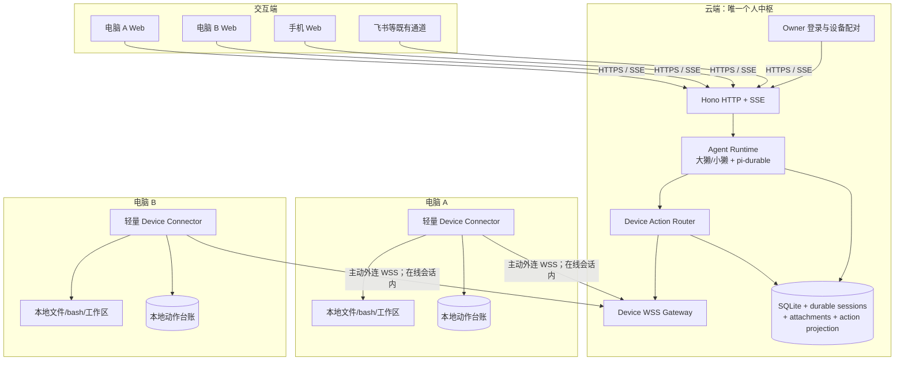
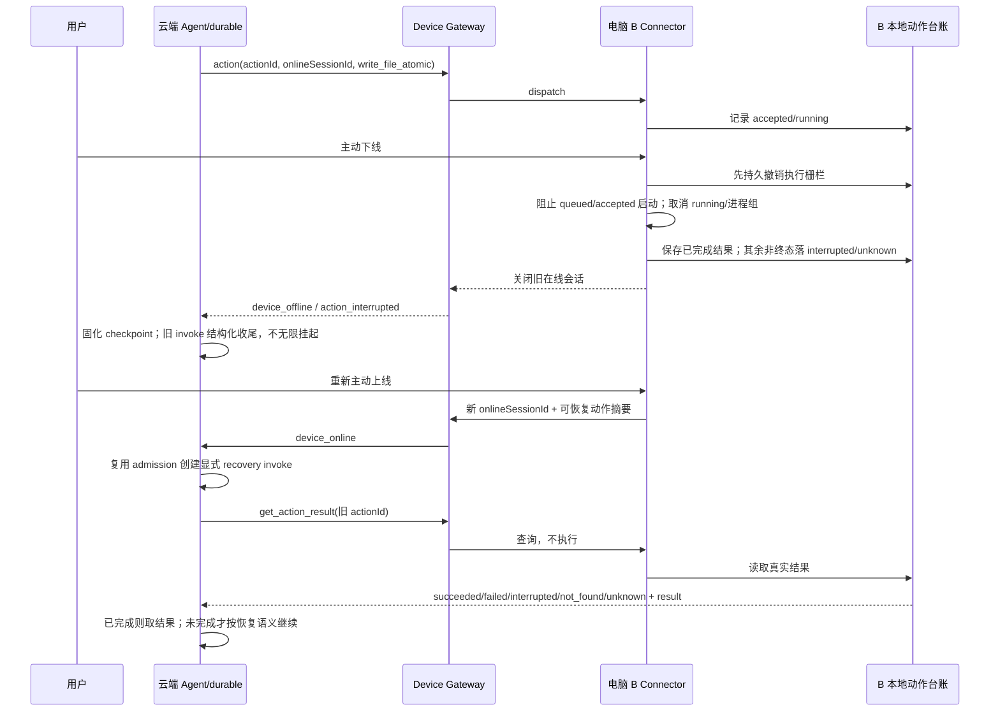

# 个人云端 Agent 中枢与多终端可恢复执行架构

> 文档性质：整体方案与施工计划，不代表已经开始实施。后续每个里程碑可拆独立特性文档与 PR，但不得改变本文已确认的产品边界。

## 1. 背景与用户意图锚

### 1.1 当前问题

现有部署图将 React SPA、Hono、Agent Runtime、Memory、SQLite 和本地工具执行放在同一台电脑。由此产生两个限制：

1. 两台电脑各自启动系统、配置模型，实际形成两套对话、记忆与运行状态，不是“同一个海獭”。
2. 即使只把现有后端搬到云端，bash、文件和工作区工具操作的也只会是云服务器，而不是用户指定的电脑。

### 1.2 已确认输入

| ID | 搭档原话/确认 | 架构结论 |
|---|---|---|
| U1 | “我还是想做个人用的 agent……部署在云端……多个电脑端/多个手机端作为入口接入” | 单用户、单云端中枢、多交互端；不做多租户 |
| U2 | “agent 具备操作电脑端能力……我正在电脑 a，然后我说你打开电脑 b 去干点什么” | 交互端与执行端解耦；工具必须携带目标设备 |
| U3 | “至于多 agent 还是单 agent……不影响部署架构设计” | 大獭/小獭数量是云端运行时内部问题，不随设备复制 |
| U4 | “当电脑端主动上线……云端就应该有跟在当前海獭系统在本机一样的权限” | 采用设备级在线总闸，不做能力/目录/动作授权矩阵 |
| U5 | “当我在电脑端主动下线时……无权限操作这台电脑……拉闸止损” | 下线由终端本地执行，旧在线会话立即失效 |
| U6 | “pi durable……可恢复性动作……做好原子动作的划分，终端下线中断并不可怕” | 设备动作按 durable action 设计；下线是可恢复中断，不是简单丢弃任务 |

## 2. 产品定义与非目标

### 2.1 一句话定义

**一个云端的个人 Agent 中枢，多个设备作为入口，多台电脑在用户主动上线期间提供完整本机执行能力，任务通过 pi-durable checkpoint 与终端原子动作台账实现中断恢复。**

### 2.2 核心使用闭环

> 用户在电脑 A 的现有对话中说“在电脑 B 写一份报告” → 云端同一个大獭解析目标 B → B 当前主动在线，连接器接收动作 → 报告在 B 的真实目录生成 → 过程与结果同步到 A、B 和手机 → 若中途 B 下线，执行停止；重新上线后从 checkpoint 和动作台账续接，不盲目重复已完成动作。

### 2.3 非目标

首版明确不做：

- 多用户、组织、租户隔离和多人权限体系。
- 每台电脑部署一套完整海獭、独立模型配置或第二份主记忆。
- 按文件/bash/GUI、目录或单个动作建立设备权限矩阵；不增加逐动作审批。
- 微服务、Kubernetes、通用消息队列、多云调度或多实例高可用。
- 全磁盘云同步；本地文件不因接入而自动上传。
- 通用远程桌面、GUI 自动化作为第一阶段交付。
- 对所有外部副作用承诺分布式 exactly-once；承诺的是可追踪、可对账、不盲重放。
- 云端或终端自动重放旧 invoke/unsafe 工具，绕过现有单主人与 admission 约束。

## 3. 核心架构

### 3.1 部署视图



### 3.2 三个平面

| 平面 | 部署位置 | 职责 |
|---|---|---|
| 交互平面 | 电脑/手机 Web、既有 IM | 发消息、查看同一对话、选择目标设备、展示动作进度与结果 |
| 中枢平面 | 云端单实例 | 对话、记忆、模型、Agent 编排、定时任务、设备注册、动作路由、审计与产物索引 |
| 执行平面 | 各电脑轻量连接器 | 主动上线/下线、本地 OS 操作、动作日志、取消/中断、结果对账 |

**关键区分：交互端不等于执行端。** 手机可以只是入口；电脑可以同时是入口和执行端；从 A 发出的请求可以把 B 作为执行端。

### 3.3 为什么不是其他形态

| 备选 | 判定 | 理由 |
|---|---|---|
| 每台电脑继续运行完整海獭，再做同步 | 否决 | 多份模型配置、记忆、会话 owner 与恢复事实源，复杂且违背“同一个海獭” |
| 只把现有后端搬上云 | 不完整 | 只能统一入口，不能操作用户电脑 |
| 云端直接 SSH 各电脑 | 非首选 | 要求网络可达/端口与凭据运维，弱在线状态、流式事件和动作恢复语义 |
| 浏览器直接承担本机执行 | 否决 | 浏览器不具备完整 OS 权限，也无法可靠充当常驻执行器 |
| 云端中枢 + 主动外连连接器 | **选定** | 无公网入站端口，天然表达上下线，支持任务路由、事件流与本地恢复台账 |

## 4. 领域模型与事实归属

### 4.1 新领域对象

| 对象 | 关键字段 | 职责 |
|---|---|---|
| `Device` | id、name、platform、publicKey、pairedAt、revokedAt | 长期设备身份；配对不等于在线授权 |
| `DeviceOnlineSession` | id、deviceId、connectedAt、disconnectedAt、disconnectReason | 一次主动上线的授权会话；动作必须绑定它 |
| `DeviceAction` | actionId、deviceId、onlineSessionId、conversationId、invokeId、kind、params、state、recoveryKind | 云端动作意图与状态投影；终端以 deviceId + actionId 跨在线会话唯一 |
| `DeviceActionEvent` | actionId、seq、state、outputRef、error、occurredAt | 状态变化与可审计历史 |
| `DeviceArtifact` 或既有 file resource 扩展 | deviceId、localPath、hash、size、cloudAttachmentId? | 明确产物位于哪台电脑；云端副本必须显式生成 |

### 4.2 事实源划分

- **云端数据库**：用户意图、对话、记忆、目标设备、编排状态、动作投影、全局审计。
- **pi-durable store**：模型对话、工具调用与 checkpoint；仍不直接写 otter 领域表。
- **终端动作台账**：本地动作是否接受、开始、完成及其真实结果，是本地执行结果的权威来源。
- **本地文件系统**：文件正文与真实路径。云端保存文件引用，不伪称天然持有副本。

不追求云端与终端同事务。通过稳定 `actionId`、终态查询和恢复对账处理两者之间的消息丢失。

### 4.3 在线授权模型

```text
未配对 → 配对完成但离线 → 用户在电脑端主动上线 → 在线授权会话
                              ↑                         |
                              └──── 再次主动上线 ← 主动下线/断线
```

1. 配对解决“这是我的哪台电脑”，不永久授予执行权。
2. 主动上线创建新的 `onlineSessionId`；每个动作必须属于该会话。
3. 主动下线由终端本地执行，顺序固定为：**先持久撤销执行栅栏 → 阻止 queued/accepted 动作启动 → 取消 running 执行器/进程组 → 落 interrupted 或 outcome_unknown → 关闭通道**。不是只把云端 UI 改成灰色。
4. 不可取消或取消回执丢失的动作显示“停止中/结果待核对”，不得伪报“已停止”；恢复时先对账。
5. 离线期间到达的请求不能执行，也不能由终端在重连后私自补跑。
6. 重新上线建立新会话；旧动作只能由云端 durable 恢复流程显式续接。
7. 在线期间，连接器提供与当前本机海獭同级的操作能力；实际权限边界是连接器所在 OS 用户，不额外提权，也不另设应用内细粒度限制。

保留的基础设施仅包括：真实 owner 登录、设备配对身份、TLS、明确目标设备、本地下线开关与审计。这些不妨碍在线期间正常行动。

## 5. 可恢复动作协议

### 5.1 动作边界

原子动作不是“越小越好”，而是满足：

- 有稳定 `actionId` 和明确输入；
- 可判定未开始、执行中、成功、失败或结果待核对；
- 完成后能查询结果；
- 中断后有明确恢复语义；
- 结果提交与回执丢失不会导致云端盲目再造一个动作。

首版动作类型以文件闭环为主：`ping`、`list_dir`、`read_file`、`write_file_atomic`、`get_action_result`。bash 在下一阶段接入，不与最小协议同时膨胀。

`write_file_atomic` 整体固定为 `reconcile`：台账内部区分 `prepared`（临时文件已写）与 `committed`（正式路径已落位）。临时文件可按 actionId 重写；正式落位后必须先核对路径与 hash，目标内容不符合预期时转 `inspect`，不得自动覆盖。

### 5.2 恢复语义

| recoveryKind | 含义 | 示例 |
|---|---|---|
| `replayable` | 相同 actionId 下可安全重试 | 读文件、列目录等只读动作 |
| `reconcile` | 必须先查终端台账/实际状态 | write_file_atomic、运行进程、上传产物 |
| `inspect` | 无法自动确认外部副作用，恢复轮先让 Agent 检查 | 外部发布、发送消息、非幂等 bash |

该分类是**执行恢复语义，不是权限等级**。默认仍是 `inspect`/unsafe；只有明确满足恢复条件的动作才能走自动续接。

### 5.3 状态与事件

```text
created → dispatched → accepted → running → succeeded
   │          │          │         ├→ failed
   │          │          │         ├→ interrupted → 等待重新上线/对账
   │          │          │         └→ cancelled
   └──────────┴──────────┴→ 会话失效时：一切非终态均转 interrupted/needs_reconcile
```

- 终端台账以 **`deviceId + actionId` 全局唯一并跨进程、跨在线会话持久**；onlineSessionId 只做执行授权栅栏和来源审计，不做去重命名空间。
- 新会话可用旧 actionId 做只读查询或显式恢复，但必须更新原动作记录，不能另建动作；旧会话的新 dispatch 一律拒绝。
- 已完成动作收到重复请求时返回已记录结果，不再次产生副作用。
- `get_action_result` 必须能返回 `not_found` 与 `unknown/indeterminate`：权威台账明确 `not_found` 且动作满足恢复条件时才可用同一 actionId 续接；`unknown` 必须转 `inspect`，禁止猜测重放。
- 每个事件携带单调序号；云端按 `actionId + seq` 去重，只应用更大 seq，终态不可被晚到旧事件回写，断线重连可补拉终态。
- 大输出采用分块、限长与附件/文件引用，不能把完整日志无界塞进模型上下文或 WebSocket 单帧。
- 不宣称通用 exactly-once。文件落位与 SQLite 提交之间仍存在极小不确定窗口，由路径、hash、actionId 台账和恢复检查共同收敛。

### 5.4 下线与恢复时序



**关键约束：** 当前 pi-durable 的 custom tools 默认 `replay: unsafe` 和“不自动重放旧 invoke”保持不变。设备上线事件触发的是 otter 显式恢复调度，不是 durable 自动重放历史工具调用；同一獭仍须经过单 writer/admission。

恢复必须有**统一持久认领**，不能让启动恢复、device_online 和人工重试各走一链。首版优先扩展现有 `restart_pending_resumes`/ResumeInterruptedService，而不是新建平行恢复台账：以 `originalInvokeId` 唯一，补充所需设备、pending/claimed/done/failed、认领信息与 `recoveryInvokeId`；三个触发源都只能 CAS 认领同一记录。设备未上线时保持 pending，通用重启恢复不得提前续跑；设备任务不能沿用“该獭之后有任意新 invoke 即已恢复”的跳过判据。设备工具先落结构化 `device_interrupted`，旧 invoke 完整终态化且 durable idle 后，才允许 recovery invoke 打开同一 checkpoint。

恢复世代必须遵守同一生命周期：

- `originalInvokeId` 在所有恢复世代中不变，`recoveryInvokeId` 只指向当前恢复轮；恢复轮再次中断仍更新同一原记录，不能另插独立根任务。
- 状态闭环为 `pending → claimed → done`；可重试崩溃或设备再下线时 `claimed → pending` 并增加 attempts，超限才进入 failed/exhausted。
- `claimed` 必须绑定 claim token 与 owner/boot epoch，不能成为无主 sticky 状态；认领、续领、释放均校验 token。
- 启动 reconcile 发现当前 recovery invoke 已 failed、不存在或不属于本进程存活轮时，回收其原记录；recovery invoke 自身不得再形成第二条恢复链。

## 6. 工具路由与用户体验

### 6.1 工具分类

| 工具类别 | 执行位置 | 示例 |
|---|---|---|
| 中枢领域工具 | 云端 | speak、memory、matters、work ledger、create_otter |
| OS/工作区工具 | 用户指定设备；未接入设备时仍是云端 | bash、文件、Git、workspace |
| 终端恢复工具 | 指定设备，只查询或按协议恢复 | get_action_result、resume/reconcile |

不得把所有工具无差别远程化。只有原本依赖电脑 OS/文件系统的工具进入 Device Action Router；对话与记忆工具继续在中枢本地执行。

### 6.2 目标设备解析

优先级固定：

1. 用户明确指定：“在电脑 B……”。
2. 当前 Web 入口绑定的“当前设备”。
3. 对话中明确且仍有效的目标设备。
4. 无目标或目标歧义时询问；不静默落到云端或另一台电脑。

浏览器不能可靠自动识别物理电脑。首版用设备选择器建立浏览器与设备的关联，不为此引入本地发现服务。手机默认没有本机执行端。

### 6.3 可见性

- 设备列表展示名称、OS、在线/离线、本次上线时间与正在执行动作数。
- 执行卡固定显示目标设备、动作类型、工作目录、状态与恢复情况。
- 所有入口通过既有 entries/SSE 看到同一任务进展；设备事件不能形成另一套聊天记录。
- 离线时明确显示“未执行/已中断”，不能显示为成功或永远运行中。
- 本地产物显示“位于电脑 B 的某路径”；只有显式上传后才能提供跨端正文预览。

## 7. 部署与代码落点

### 7.1 云端部署

首版保持：

- 一个 Node.js/Hono 服务，单实例单 writer。
- 持久卷保存 otter SQLite、每獭 durable SQLite、附件与配置。
- HTTPS 反向代理；WSS 与 Web 共用域名。
- 真实 owner 登录会话替代公网环境下可伪造的声明式身份头；保留现有路由策略表与 fail-closed，替换身份值源。
- 数据库与 durable session 一起备份；备份恢复后进行单实例验证，禁止两个实例共用同一数据域。
- 本地 embedding 可继续运行在云端；资源不足是后续独立优化，不在本项目改成外部服务。

### 7.2 电脑连接器

- 独立轻量入口/包，不加载 LLM、embedding、React 或主记忆系统。
- 常驻进程与“在线授权”分离：进程启动不自动代表用户主动上线。
- 提供明确 `online`、`offline`、状态和配对入口；首发只支持搭档两台电脑的共同 OS，其他平台不在同一验收中承诺。
- 本地 SQLite/append-only 台账只保存动作与结果，不保存第二份对话事实。
- bash 阶段使用进程组取消、超时和输出限流；GUI 权限后置。

### 7.3 建议模块

| 模块 | 职责 |
|---|---|
| `src/entities/device/` | Device、OnlineSession、Action 状态与值对象 |
| `src/usecases/device/` | 配对、上下线投影、动作编排、恢复对账 |
| `src/frameworks/db/device/` | 云端设备/动作投影持久化 |
| `src/interface-adapters/device-gateway/` | WSS、协议校验、心跳、事件入库 |
| `src/interface-adapters/agent-runtime/tools/device-*` | OS 工具到目标设备动作的适配 |
| `src/interface-adapters/http/controllers/device-controller.ts` | 设备列表、配对码、动作只读查询 |
| `api-contract/` | Web 设备 DTO、WSS 消息类型与共享协议 fixtures；保持现有轻量契约约束 |
| `device/`（建议独立轻量包） | 连接器 CLI、本地执行器、动作台账与 WSS 客户端 |
| `web/src/pages/devices/`、`web/src/api/devices.ts` | 设备管理、当前设备选择与状态展示 |

上述是施工映射，不要求一次 PR 全建。协议验证必须在接收端 fail-closed；未知协议版本、未知动作类型、过期 onlineSessionId 均拒绝执行。

## 8. 施工计划

### 8.1 总体顺序

```text
M0 云端可安全访问
  → M1 设备身份与在线总闸
  → M2 单设备最小文件动作
  → M3 durable 中断恢复
  → M4 双电脑/手机纵向验收
  → M5 本机能力对齐（bash/Git/附件）
  → M6 按需浏览器/GUI/部署增强
```

M0 与连接器协议骨架可以并行设计，但 M2 之前必须完成真实认证与设备会话校验。每个里程碑独立可验收，禁止以“架构已搭好”代替真实行为闭环。

### 8.2 M0：云端单中枢与多入口

**交付**

- 云端单实例部署、HTTPS、持久卷、备份与启动/停止脚本。
- supervisor/容器单副本配置是交付物：禁止滚动替换期间旧新进程同开同一 durable 数据域；第二实例必须在打开 store 前由部署层阻止。
- 备份采用停服务后的一致性快照，覆盖 otter DB、每獭 durable DB 与附件，避免跨文件时间点错位。
- 既有数据上云：选定当前主电脑为唯一数据源，源服务停止后一次性导入对话、记忆、durable session、附件与配置，并校验数量与完整性；不允许两台旧系统双向合并。
- owner 真实登录会话；现有声明式身份头不再作为公网认证依据。
- 电脑 A、B、手机登录后看到同一对话、记忆、配置与任务历史。
- UI 明示当前 OS 工具仍执行在“云端”，避免误以为已能操作本机。

**验收**

- 未登录访问 API 失败；会话过期/退出后失败。
- A 发消息，B 与手机通过 SSE/刷新看到同一 entry。
- 云端重启后对话、durable session 与附件仍在；部署层能阻止第二个数据域 writer，备份恢复后数量/完整性校验通过。

### 8.3 M1：设备配对与在线总闸

**交付**

- Device 注册、配对码、设备密钥、吊销。
- 连接器主动 WSS 外连、协议版本、心跳与在线会话。
- 本地 `online/offline/status`；上线才创建授权会话，下线本地撤销。
- 云端设备列表与显著在线状态；离线动作入口返回结构化 `device_offline`。

**验收**

- 未配对、吊销、错误密钥、过期会话均不能执行。
- 进程启动但未主动上线 = 离线。
- 下线后旧 onlineSessionId 请求被终端拒绝；云端伪造/重放缓存消息也无效。
- 离线期间消息不会在连接器自行重连时补跑。

### 8.4 M2：单设备最小文件执行闭环

**交付**

- Device Action Router、云端投影、终端台账和事件流。
- `ping/list_dir/read_file/write_file_atomic/get_action_result`。
- 对话工具携带目标设备；执行卡显示真实设备与路径。
- 临时文件 + 原子重命名 + hash/元数据结果；产物资源携带 deviceId/localPath。

**验收**

- 在电脑 A 对话中指定电脑 B，报告实际出现在 B；云端磁盘没有同名“假产物”。
- A、B 的 Web 均显示同一动作状态。
- 重复 dispatch 同 actionId 不重复执行；结果可查询；旧会话已完成、新会话以同 actionId 再 dispatch 时执行计数仍为 1。
- 文件动作在 queued/accepted/running 各阶段下线，均不能越过本地执行栅栏；无法确认停止结果时显示待核对而非已停止。
- 未知动作、畸形参数、旧会话均 fail-closed。

### 8.5 M3：pi-durable 中断与恢复

**交付**

- 动作 recoveryKind、终端终态查询（含 not_found/unknown）、云端对账服务。
- 旧 invoke 结构化中断收尾；重新上线后复用 admission 创建显式 recovery invoke。
- 扩展现有重启恢复队列形成统一持久认领：originalInvokeId 唯一、设备等待、CAS claim、recoveryInvokeId；启动/online/人工重试共享同一记录。
- durable checkpoint、conversation/invoke、DeviceAction 和终端 actionId 的关联。
- 同獭单 writer、恢复轮幂等、重复 online 事件去重；旧轮 settle/durable idle 后才允许新恢复轮。

**验收（真实进程/连接中断，不只 mock）**

1. 临时文件阶段下线 → 不再执行 → 重上后续接 → 报告只生成一次。
2. 正式文件已落位但云端未收到回执 → 重上后通过对账取结果 → 不重复落后续动作。
3. dispatched-before-accept、accepted-before-running 两个窗口断线 → 非终态有明确中断出口 → not_found/unknown 按协议处理，不卡住或猜测重放。
4. 台账不存在或损坏 → unknown/inspect，禁止自动覆盖或重放。
5. 云端在动作运行中重启 → checkpoint 可读 → 不自动重放 unsafe 工具。
6. 终端进程被 SIGKILL → 台账重开 → 已完成动作副作用计数不增加。
7. 云端重启时设备仍离线 → 保持 pending；上线后只恢复一次。
8. online 与 startup 同时触发、人工重试并发 → 同一 originalInvokeId 只有一次 CAS 认领；无关新 invoke 不吞掉待恢复项。
9. claim 后未建 invoke 即云端 SIGKILL → 启动后回收 claimed → 后续恢复不 stuck。
10. recovery invoke 运行中云端 SIGKILL → 沿用同一 originalInvokeId 回收并续接 → 不产生第二条恢复链。
11. recovery 中设备再次下线 → claimed 回到 pending 并计 attempts → 重上后只有一个后续 recovery writer。
12. 同一设备快速重复 online、云端重复恢复调度 → 不出现双 recovery writer。

### 8.6 M4：双电脑与手机端到端首发

**交付**

- 当前设备选择器、明确设备路由、跨端状态呈现。
- 首份用户指南：云端部署、设备配对、主动上下线、报告位置与显式上传。
- 真实双电脑 + 手机验收脚本/清单。

**首发验收主场景**

- A 发起“在 B 的指定目录写报告”；B 在线执行；手机看到进度；B 产物可定位。
- 中途 B 主动下线，执行停止；A/手机看到 interrupted；B 重上后恢复成功。
- A 离线不影响“从手机指挥 B”；未指定且无法推断目标时系统询问。

### 8.7 M5：现有本机能力对齐

按独立 PR 逐步接入，不一次性开放未知面：

1. **bash**：流式输出、超时、进程组取消、输出截断、恢复分类；主动下线后进程组退出，晚到事件不能复活旧会话；保留现有工具链规则，不新增云端专属权限枷锁。
2. **工作区/Git**：真实设备 workspace、文件预览、仓内状态与既有 worktree 流程。
3. **附件/产物**：显式上传云端副本、设备间文件传输任务；不默认全量同步。
4. **定时任务**：设备离线时按现有任务语义明确失败或等待恢复，不静默在云端执行同名命令。

每项都必须补“目标设备、离线、重复 actionId、取消、恢复”的负向测试。

### 8.8 M6：后续按需

- 浏览器/应用自动化、macOS/Windows GUI 权限与操作回显。
- 更友好的菜单栏/托盘连接器。
- 只有出现真实负载或高可用需求后，才评估外置数据库、队列与多实例；届时仍需先解决 durable 单主人与数据域归属。

## 9. PR 切分与依赖

| 顺序 | 施工单元 | 依赖 | 可独立验收 |
|---|---|---|---|
| 1 | 云部署 + owner session | 无 | 多入口登录同一中枢 |
| 2 | 设备协议 + 配对 + 在线会话 | 1 | 上下线总闸，无业务动作 |
| 3 | 终端台账 + ping/get_action_result | 2 | 重连/重复消息不重复执行 |
| 4 | 文件动作 + Agent 工具路由 + 执行卡 | 3 | A 让 B 写报告 |
| 5 | durable 恢复调度 + 对账 | 4 | 两个断点窗口恢复且不盲重放 |
| 6 | 双电脑/手机验收 + 用户指南 | 5 | 首发闭环 |
| 7+ | bash、Git、附件、GUI 等 | 6 | 每能力独立闭环 |

预计首发为 **6 个主要施工单元**，每个可再按实际规模拆 PR；不在此计划中承诺日历工期。每个 PR 必须通过现有 build/lint/test、协议负向测试和对应真实行为验收，文档合入不等于部署生效。

## 10. 测试与观测

### 10.1 测试层级

- **契约测试**：WSS 消息、版本、状态迁移、非法输入、未知类型、事件去重。
- **领域测试**：在线会话失效、跨会话 actionId 唯一、目标解析、全非终态中断出口、恢复分类、统一恢复认领与单 writer。
- **集成测试**：真实 WebSocket、真实终端临时目录、真实 SQLite 台账与 durable store。
- **崩溃测试**：终端 SIGKILL、云端 SIGKILL、回执丢失、重复调度、网络重连。
- **真实设备验收**：两台电脑 + 一部手机，覆盖 M4 主场景；mock 不能替代。

### 10.2 日志与指标

复用现有 pino/prom-client 与 traceId，新增：

- `deviceId`（日志使用不敏感别名）、`onlineSessionId`、`actionId`、`invokeId`、state、recoveryKind。
- 在线设备数、动作延迟、动作状态计数、重连次数、对账命中数、重复 dispatch 去重数、恢复成功/失败数。
- 默认不把报告正文、密钥、完整敏感命令输出写入指标标签；大日志以引用代替内联。

## 11. 风险与缓解

| 风险 | 影响 | 缓解 |
|---|---|---|
| 云端被攻破且设备在线 | 在线设备暴露完整用户权限 | 显著在线状态、随时本地下线、缩短暴露窗口；接受这是在线总闸模型的边界 |
| 把云端显示离线当成真实拉闸 | 旧任务仍可能执行 | 终端本地验证 onlineSessionId 并拒绝旧动作 |
| 回执丢失导致副作用重复 | 文件/外部动作重复 | actionId、本地台账、终态查询、恢复对账；不盲重放 |
| 旧 invoke 与恢复 invoke 双跑 | 双写与状态污染 | 旧轮结构化收尾；恢复复用现有 admission；durable 不自动 replay |
| 浏览器误认当前设备 | 写错电脑 | 显式选择器 + 明确指令优先 + 歧义询问 |
| 文件路径被误当云端可用 | 跨端预览失败/假成功 | 所有本地产物携带 deviceId/localPath；云端副本显式生成 |
| 大输出阻塞 WS/模型上下文 | 延迟、内存与上下文膨胀 | 分块、限长、背压、文件/附件引用 |
| 云端单实例故障 | 全部入口暂时不可用 | 持久卷、备份、快速重启；首版不伪称高可用 |
| 连接器变成第二个完整海獭 | 配置与事实源再次分裂 | 只允许动作协议、本地台账和执行器，不加载模型/主记忆 |

## 12. 架构决策记录

| # | 决策 | 状态 | 理由 |
|---|---|---|---|
| D1 | 单用户、单云端中枢、多交互入口 | 已确认 | 目标是个人 Agent，不是多人系统 |
| D2 | 电脑通过轻量连接器主动外连 | 提案选定 | 避免入站端口，表达在线状态并执行本地动作 |
| D3 | 大獭/小獭不随设备复制 | 已确认 | 多 Agent 是内部架构，与部署解耦 |
| D4 | 设备主动上线即授予本机同级权限 | 已确认 | 保留 Agent 行动力，避免细粒度权限成为枷锁 |
| D5 | 主动下线由终端本地撤销在线会话 | 已确认 | 云端被攻破时提供真实拉闸，而非 UI 假象 |
| D6 | 使用 durable checkpoint + 原子动作台账恢复 | 已确认方向 | 将下线转化为可恢复中断 |
| D7 | 不自动重放 unsafe 工具/旧 invoke | 延续现有约束 | 防止恢复导致重复副作用与双 writer |
| D8 | 本地文件默认留在设备，云端副本显式产生 | 提案选定 | 尊重真实文件位置，避免隐式同步 |
| D9 | 首版单 Node + SQLite 持久卷 | 提案选定 | 满足个人规模，避免分布式过度设计 |
| D10 | 首条纵向闭环是 A 让 B 写报告、手机看结果 | 提案选定 | 同时验证入口、路由、执行、恢复与跨端状态 |

## 13. 方案完成判定

本方案文档只完成设计闭环，不声称系统已具备能力。实际项目完成首发必须同时满足：

- M0–M4 全部真实验收通过；
- 双电脑不再各自维护模型与主记忆；
- 在线期间本机能力可用，离线后终端真实拒绝；
- 至少两个中断窗口经真实测试恢复，且未盲重放；
- 报告等本地产物的设备归属与路径清晰；
- 手机可进入同一对话并查看/参与同一任务；
- 未引入多租户、微服务、分布式队列或细粒度设备权限等首版非目标。
